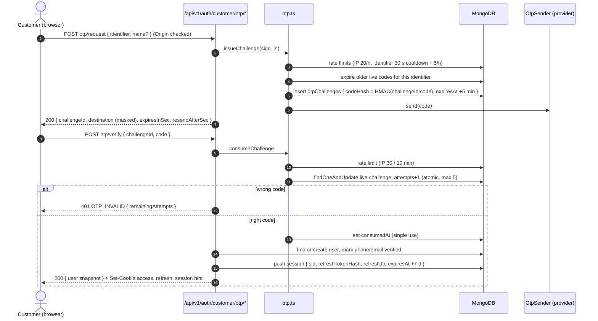
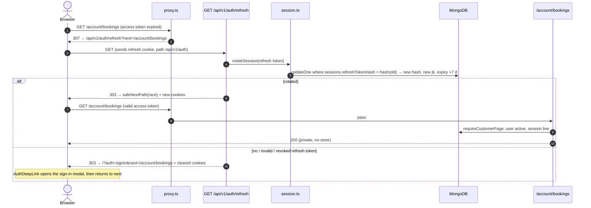
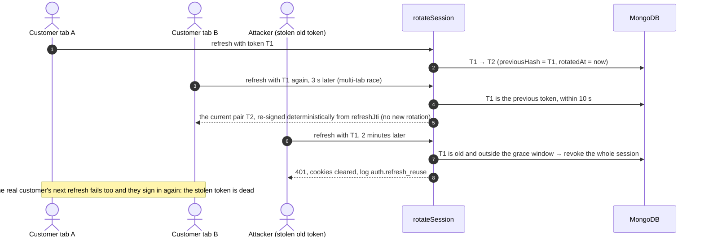

# Customer authentication

> How customers sign in to ShowBuzz, how sessions are kept and ended, what the system defends against, and what
> must change before launch. Staff/admin sign-in is a separate system (Phase 5) and is not covered here.
> Last reviewed: 2026-10-13 (batch 1.9).

## 1. Overview

- **One flow for sign-in and registration.** The customer types a phone number or email and gets a 6-digit code.
  Verifying a code for an unknown identifier creates the account, so the API never reveals whether an account
  exists. The "Register" tab only adds a name.
- **Sessions are server-side records, carried by short JWTs.** Signing in creates an entry in
  `users.sessions[]` (one per device, max 10) and sets two `httpOnly` cookies: a 15-minute access token and a
  7-day refresh token. The refresh token is rotated on every use, stored only as a SHA-256 hash, and can be revoked.
- **Two layers of route protection.** `apps/web/src/proxy.ts` does a fast JWT-only check on `/account/**` page loads. The
  real boundary is server-side: every page, Server Action and route handler that needs a customer calls
  `requireCustomerPage()` / `requireCustomer()` / `requireCustomerSession()`, which re-check the user is active and
  the session still exists in MongoDB. Logging out or revoking a device takes effect immediately, not when the access
  token expires.
- **Sensitive changes need a fresh proof (step-up).** Changing or removing a phone/email needs this device to have
  signed in, or confirmed a "confirm it's you" code, in the last 10 minutes. Deleting the account always needs a code.

| Piece                 | Where                                                                                    |
| --------------------- | ---------------------------------------------------------------------------------------- |
| OTP issue / verify    | `packages/core/src/auth/otp.ts`, delivery in `otp-delivery.ts`, model `OtpChallenge`            |
| Tokens                | `packages/core/src/auth/jwt.ts` (jose, no DB import, so the proxy can use it)                   |
| Sessions              | `packages/core/src/auth/session.ts` (`createSession`, `rotateSession`, `revokeSession`, ...)    |
| Cookies               | `packages/core/src/auth/cookies.ts`                                                             |
| Sign-in orchestration | `packages/core/src/auth/customer-auth.service.ts`                                               |
| Route handlers        | `apps/web/src/app/api/v1/auth/**` (documented in `docs/openapi.yaml`)                             |
| Server Actions        | `apps/web/src/app/(public)/_actions/auth.ts`, `account.ts`                                        |
| Server-side guards    | `packages/core/src/auth/current-customer.ts`                                                    |
| Page-load gate        | `apps/web/src/proxy.ts` → `decideCustomerRoute()` in `packages/core/src/auth/route-guard.ts`             |
| Account management    | `packages/core/src/services/account.service.ts` (profile, contact change, step-up, deletion)    |
| Client                | `apps/web/src/stores/auth.ts`, `SessionBootstrap`, `use-session-keep-alive.ts`, `use-sign-out.ts` |
| Limits and lifetimes  | `AUTH` in `packages/schemas/src/constants.ts`                                                      |

## 2. Flows

### 2.1 OTP sign-in / registration



### 2.2 Refresh, including the proxy bounce

Two ways to refresh: page navigations bounce through `GET /api/v1/auth/refresh?next=`, and the client keep-alive
calls `POST /api/v1/auth/refresh` 60 s before expiry and on tab focus. The refresh cookie is scoped to
`/api/v1/auth`, so only these routes ever see it.



`safeNextPath()` (`packages/utils/src/safe-next.ts`) only accepts same-site relative paths, so `next` can't become an open
redirect. Link prefetches skip the proxy (matcher `missing` on prefetch headers) so a prefetch never rotates tokens.

### 2.3 Logout

```mermaid
sequenceDiagram
    autonumber
    actor C as Browser
    participant L as POST /api/v1/auth/logout
    participant DB as MongoDB

    C->>L: POST (Origin checked; sends access + refresh cookies)
    L->>DB: $pull session by sid (from the access token, or the refresh token if the access token has expired)
    L-->>C: 200 + all three cookies expired (each on its own path)
    Note over C: useSignOut() clears the auth store and refreshes the router
    Note over DB: Any access token still held for that sid now fails requireCustomer* (session gone)
```

"Sign out other devices" and per-device revoke on the Security tab do the same against other `sid`s.

### 2.4 Refresh-token reuse detection



### 2.5 Step-up ("confirm it's you")

`startContactChange` and `removeContact` call `requireRecentAuth()`: this session's `createdAt` or
`reauthenticatedAt` must be under `AUTH.stepUpWindowSec` (10 min) old, otherwise they answer
`403 STEP_UP_REQUIRED`. The profile UI then sends a code (`purpose: reauthenticate`, to the customer's own
phone, falling back to email), and once it's confirmed it sets `sessions.$.reauthenticatedAt` for **this device only**
and retries the blocked step.

## 3. Cookies

Names in production / development. All are `httpOnly`, `SameSite=Lax` and `Secure` in production.

| Cookie                                     | Content     | Path           | Lifetime                        | Purpose                                                                                      |
| ------------------------------------------ | ----------- | -------------- | ------------------------------- | -------------------------------------------------------------------------------------------- |
| `__Host-sb_at` / `sb_at`                   | Access JWT  | `/`            | 15 min (token expiry)           | Identifies the customer on pages, Server Actions and route handlers                          |
| `__Secure-sb_rt` / `sb_rt`                 | Refresh JWT | `/api/v1/auth` | 7 days, slides on each rotation | Only the refresh and logout routes receive it; Server Actions never do                       |
| `__Host-sb_has_session` / `sb_has_session` | `1`         | `/`            | Same as the refresh token       | Tells the server a session may exist, so an expired access token triggers one silent refresh |

`__Host-` means the cookie can't be set by a subdomain or for another path; `__Secure-` (refresh) is used because
`__Host-` requires `Path=/`.

## 4. Token claims

Both tokens: `alg: HS256`, `iss: showbuzz`, `aud: showbuzz-public`, `sub` = user id, `sid` = session id, `iat`,
`exp`. Verification pins the algorithm, checks issuer, audience and `typ`, and allows 5 s of clock skew.

| Claim | Access              | Refresh                                                       |
| ----- | ------------------- | ------------------------------------------------------------- |
| `typ` | `access`            | `refresh` (an access token never passes as refresh, and back) |
| `jti` | none                | Random per rotation; stored as `refreshJti` on the session    |
| Key   | `JWT_ACCESS_SECRET` | `JWT_REFRESH_SECRET` (must differ)                            |
| `exp` | `iat` + 15 min      | `iat` + 7 days                                                |

Admin tokens (Phase 5) will use `aud: showbuzz-admin` and their own cookies, so a customer token can never open the
console.

## 5. Rate limits

Fixed windows in the `rateLimits` collection (keys stored as SHA-256 hashes, TTL cleanup). A denial is
`429 RATE_LIMITED` with `details.retryAfterSec` and a `Retry-After` header on route handlers.

| Limit                        | Key        | Allowance     | Where                    |
| ---------------------------- | ---------- | ------------- | ------------------------ |
| Code requests per network    | IP         | 20 / hour     | `issueChallenge`         |
| Resend cooldown              | Identifier | 1 / 30 s      | `issueChallenge`         |
| Code requests per identifier | Identifier | 5 / hour      | `issueChallenge`         |
| Verify attempts per network  | IP         | 30 / 10 min   | `consumeChallenge`       |
| Guesses per code             | Challenge  | 5 (then dead) | `otpChallenges.attempts` |
| Contact-change starts        | User       | 5 / hour      | `startContactChange`     |
| Contact-change starts        | IP         | 20 / hour     | `startContactChange`     |

Codes expire after 5 minutes and only the newest code for an identifier and purpose works. IP-based limits are
skipped when the client IP can't be determined (see follow-up F6).

## 6. Threat model and security review

Reviewed against OWASP ASVS v5 (V6 Authentication, V7 Session Management, V8 Authorization, V3 Web Frontend
Security) and the OWASP API Security Top 10 (2023) on 2026-10-13.

### 6.1 Findings

| #   | Severity | Finding                                                                                                                                                                          | Status                                                                                                                                                                                                                                     |
| --- | -------- | -------------------------------------------------------------------------------------------------------------------------------------------------------------------------------- | ------------------------------------------------------------------------------------------------------------------------------------------------------------------------------------------------------------------------------------------ |
| F1  | High     | With `OTP_PROVIDER=none` (the default) every sign-in code is written to the server log, in production too. Anyone with Vercel log access can sign in as any customer. ASVS V6.6. | **Partly fixed** (2026-10-16): with `OTP_PROVIDER=appdoot` SMS codes are really sent and never logged (§7.1). Codes to an **email** address still fall back to the log, because no email provider is chosen yet (§7.2) — still the first item of the production checklist (§8). |
| F2  | Medium   | A stolen session (or an unattended signed-in device) could add the attacker's email, verify it, then remove the victim's phone and keep the account. ASVS V6.8, V7.5.            | **Fixed.** Step-up: changing or removing a phone/email needs a sign-in or "confirm it's you" code on this device within 10 minutes (`requireRecentAuth`, `purpose: reauthenticate`). Tests in `tests/integration/account/account.test.ts`. |
| F3  | Medium   | "Change phone/email" answered 409 for identifiers taken by another account before any rate limit ran, an unlimited "is this number registered?" lookup. API3/API4.               | **Fixed.** Per-user (5/h) and per-IP (20/h) limits now run before the existence check, so probing stops after 5 tries an hour per account. Tested.                                                                                         |
| F4  | Medium   | To verify: account, checkout and booking-success pages render personal data; with Cache Components their static shell might be cacheable by a CDN or shared proxy.               | **Pass, no change.** Production build checked with real cookies: every page is sent `Cache-Control: private, no-cache, no-store, max-age=0, must-revalidate`; signed-out `/account/*` gets a 307 to the refresh route.                     |
| —   | Medium   | `getCurrentSession()` read the clock (`new Date()`) during partial prefetch rendering, which Next rejects ("unstable value") and which broke the first E2E run on `/movies`.     | **Fixed.** `await connection()` before reading the clock in `packages/core/src/auth/current-customer.ts`.                                                                                                                                         |
| F5  | Low      | Signing in again on the same device creates a new session; the old one lives on until it expires or is evicted (max 10).                                                         | Follow-up: on verify, revoke the session named by an existing refresh cookie.                                                                                                                                                              |
| F6  | Low      | Per-IP limits are skipped when no client IP can be read (no `x-forwarded-for`). On Vercel the header is always set, so this only matters for other hosts.                        | Follow-up: fall back to a shared "unknown" bucket with a tighter limit.                                                                                                                                                                    |
| F7  | Low      | Order creation, review submission and lead forms have no rate limit yet (they are in-memory stand-ins). API4.                                                                    | Follow-up with the DB-backed versions (3.4, 4.1, 4.3).                                                                                                                                                                                     |
| F8  | Low      | No Content-Security-Policy, so an XSS bug would have nothing to stop it (tokens stay safe in `httpOnly` cookies, but actions could be made as the user). ASVS V3.4.              | Planned in batch 8.2.                                                                                                                                                                                                                      |
| F9  | Low      | Every public page (`/`, `/movies`) is also `no-store`, because the public layout reads cookies for the header. Not a security issue, but it costs CDN caching.                   | Follow-up for 8.3 (render the header session part as a client island or a separately streamed hole).                                                                                                                                       |

### 6.2 Checked and passing

| Area                     | What was checked                                                                                                                                                                                                              |
| ------------------------ | ----------------------------------------------------------------------------------------------------------------------------------------------------------------------------------------------------------------------------- |
| Account enumeration      | Request and verify answer the same for known and unknown identifiers; registration is the same flow. Contact change says "can't be used" without saying why, and is now rate-limited (F3).                                    |
| OTP brute force          | 6 digits, 5 guesses per code counted atomically, IP and identifier limits, 5-minute expiry, newest code only. Codes come from `crypto.randomInt`.                                                                             |
| OTP replay and binding   | `consumedAt` makes codes single use. Codes are HMAC'd with the challenge id, bound to `purpose`, and for account actions to `userId`, so a sign-in code can't confirm a deletion and one customer's code can't serve another. |
| OTP at rest              | Only the HMAC (`OTP_HASH_SECRET`) is stored; comparisons are constant-time.                                                                                                                                                   |
| JWT handling             | HS256 pinned (no `alg: none` / key confusion), issuer, audience and `typ` checked, required claims enforced, separate keys for access and refresh, secrets ≥ 32 chars validated at boot.                                      |
| Session lifecycle        | Server-side session list; logout, device revoke, sign-out-everywhere and account deletion take effect at once because every guard re-checks the session in MongoDB. Refresh rotation with reuse detection.                    |
| Cookies                  | `httpOnly`, `Secure`, `SameSite=Lax`, `__Host-`/`__Secure-` prefixes in production; refresh cookie limited to `/api/v1/auth`.                                                                                                 |
| CSRF                     | `SameSite=Lax`, `assertSameOrigin()` on every state-changing auth route, Next's origin check on Server Actions. GET refresh only rotates and redirects to a validated path.                                                   |
| Open redirect            | `next` passes through `safeNextPath()` in the refresh route, the proxy and the modal.                                                                                                                                         |
| Object-level authz       | Bookings and reviews are looked up by owner (`userId`) server-side (batch 1.8); another customer's booking id answers "not found".                                                                                            |
| Blocked/deleted users    | `status` is re-checked on every guarded request, and refresh fails for non-active users. Deletion tombstones the user and clears sessions.                                                                                    |
| Logging                  | The logger redacts secret-like fields and masks emails/phones; tokens are never logged; IPs are stored only as /24 or /48 prefixes. The OTP log line is the one agreed exception (F1).                                        |
| Caching of personal data | F4 above; API responses are `no-store` by default via `apiHandler`.                                                                                                                                                           |
| Security headers         | nosniff, Referrer-Policy, `X-Frame-Options: DENY`, Permissions-Policy, HSTS outside development (CSP pending, F8).                                                                                                            |

### 6.3 Out of scope for now

Social login (buttons say "coming soon"), admin/staff authentication (Phase 5), bot protection such as CAPTCHA on
OTP requests (revisit if SMS costs or abuse show up after launch), SIM-swap risk inherent to SMS OTP.

## 7. Delivering codes: Appdoot for SMS, email still a stand-in

Delivery is behind one interface in `packages/core/src/auth/otp-delivery.ts`:

```ts
export interface OtpSender {
  // message: { channel, to (E.164 or lowercase email), code, purpose, challengeId }
  send(message: OtpMessage): Promise<OtpSendResult>;
}
```

`getOtpSender()` picks the implementation from `OTP_PROVIDER`:

| `OTP_PROVIDER`              | SMS                               | Email                             |
| --------------------------- | --------------------------------- | --------------------------------- |
| `appdoot`                   | `AppdootOtpSender` (really sends) | `LogOtpSender` (still a stand-in) |
| `none` (default)            | `LogOtpSender`                    | `LogOtpSender`                    |
| `dev` (E2E, not production) | `DevOtpSender` (on screen only)   | `DevOtpSender`                    |

### 7.1 Appdoot (SMS, chosen 2026-10-16)

`packages/core/src/auth/appdoot-otp.ts` posts to `{APPDOOT_BASE_URL}/send-transactional` with the `X-App-Id` and
`X-Secret-Key` headers — no SDK, a plain `fetch` with an 8-second timeout — sending `recipient_phone`,
`template_id`, `variables: { 1: code }` and `idempotency_key`.

- **One template for every purpose.** The DLT-registered `authentication` template's only variable is the code
  ("Your OTP for verification is {{1}}. It is valid for 5 minutes…"), so sign-in, contact change, deletion and
  re-authentication all use it. Its "valid for 5 minutes" matches `AUTH.otpTtlSec`; change both together.
- **The idempotency key is the challenge id** (`otp-<challengeId>`), so a retried send for the same challenge
  can't bill or deliver a second SMS, while every new code is a new challenge and does send.
- **Config:** `APPDOOT_APP_ID` and `APPDOOT_SECRET_KEY`, plus optional `APPDOOT_OTP_TEMPLATE_ID` (default
  `authentication`) and `APPDOOT_BASE_URL`, validated lazily in `packages/runtime/src/appdoot-env.ts` so a
  deployment still on `none`/`dev` boots without them. Both the web app (customer sign-in) and the partner app
  (vendor signup mobile verification) need them; `turbo.json` declares them as `APPDOOT_*`.
- **Failures** (timeout, network error, non-2xx) log `otp.appdoot_unreachable` / `otp.appdoot_rejected` with the
  challenge id and throw `AppError("OTP_SEND_FAILED", …, 502)`. `issueChallenge` then expires the challenge it
  just created, so the customer sees "We couldn't send the code right now" and no live code is left behind. The
  code itself is never logged and never returned to the client.

### 7.2 Remaining: an email provider

Codes sent to an email address still go through `LogOtpSender`, which writes them to the server log (F1 above,
now limited to the email channel). To close it:

1. **Pick an email provider.** Ask before installing an SDK; a plain `fetch` to its REST API is usually enough.
2. **Add its credentials** in a lazily-parsed module next to `appdoot-env.ts`, and list the variables in each
   app's `.env.example` and in `turbo.json`.
3. **Implement `OtpSender`** next to `AppdootOtpSender`: return `{}` (never the code), throw
   `AppError("OTP_SEND_FAILED", …, 502)` on failure, and use `challengeId` as the idempotency key.
4. **Route it** in `getOtpSender()`: `new ChannelOtpSender({ sms: new AppdootOtpSender(), email: new … })`.
5. **Remove the logging exception:** delete `LogOtpSender` (or make `none` refuse to start in production), and
   delete the matching notes in CLAUDE.md §11/§12, the roadmap "OTP delivery" decision and §6.1 F1 here.
6. **Test** with a mocked `fetch` (unit) and keep E2E on `OTP_PROVIDER=dev`; never call a real provider from tests.

## 8. Production checklist

- [ ] `OTP_PROVIDER=appdoot` with `APPDOOT_APP_ID` / `APPDOOT_SECRET_KEY` set in Production **and** Preview, in
      the **web and partner** projects, and the `authentication` template approved on the DLT registration (§7.1).
- [ ] An email provider is configured too (§7.2), so email codes stop going to the log (F1).
- [ ] `OTP_PROVIDER` is not `dev` anywhere deployed (boot already rejects `dev` when `NODE_ENV=production`) and
      not `none` in Production (F1).
- [ ] `JWT_ACCESS_SECRET`, `JWT_REFRESH_SECRET` and `OTP_HASH_SECRET` are set **separately** for Development,
      Preview and Production on Vercel, each ≥ 32 random characters (`openssl rand -base64 48`), never shared.
      Rotating a JWT secret signs everyone out; rotating `OTP_HASH_SECRET` invalidates codes in flight only.
- [ ] `NEXT_PUBLIC_APP_URL` is the canonical HTTPS origin (the Origin check and cookies depend on it).
- [ ] `MONGODB_URI` points at a replica set with backups; `pnpm db:sync-indexes` has been run (TTL indexes on
      `otpChallenges` and `rateLimits`, unique partial indexes on `users.phone` / `users.email`).
- [ ] The test users created during development (`manual-test@showbuzz.dev`, `manual-test-2@showbuzz.dev`) are
      removed from the production database.
- [ ] Vercel log retention and access are limited to the people who need them.
- [ ] CSP is in place (batch 8.2) and the low findings F5–F7 are closed or explicitly accepted.

## 9. Tests

| Layer       | Where                                                         | Covers                                                                                                                                             |
| ----------- | ------------------------------------------------------------- | -------------------------------------------------------------------------------------------------------------------------------------------------- |
| Unit        | `tests/unit/server/auth/*`, `tests/unit/schemas/auth.test.ts` | JWT verification rules, route guard decisions, safe `next`, identifier parsing                                                                     |
| Integration | `tests/integration/{auth,api,account}/*`                      | OTP limits, attempts, single use; session rotation and reuse; auth routes; profile, contact change, step-up, deletion                              |
| E2E         | `apps/web/tests/e2e/auth.spec.ts` (`pnpm test:e2e`)                 | Phone sign-in back to the start page and survives reload; email registration; wrong code and resend timer; protected page → modal → back; sign out |

E2E runs `next dev` on port 3100 against an in-memory MongoDB replica set started by `apps/web/tests/e2e/server.ts`, with
`OTP_PROVIDER=dev` so the specs read the code from the on-screen development banner. It never touches `.env.local`'s
database.
